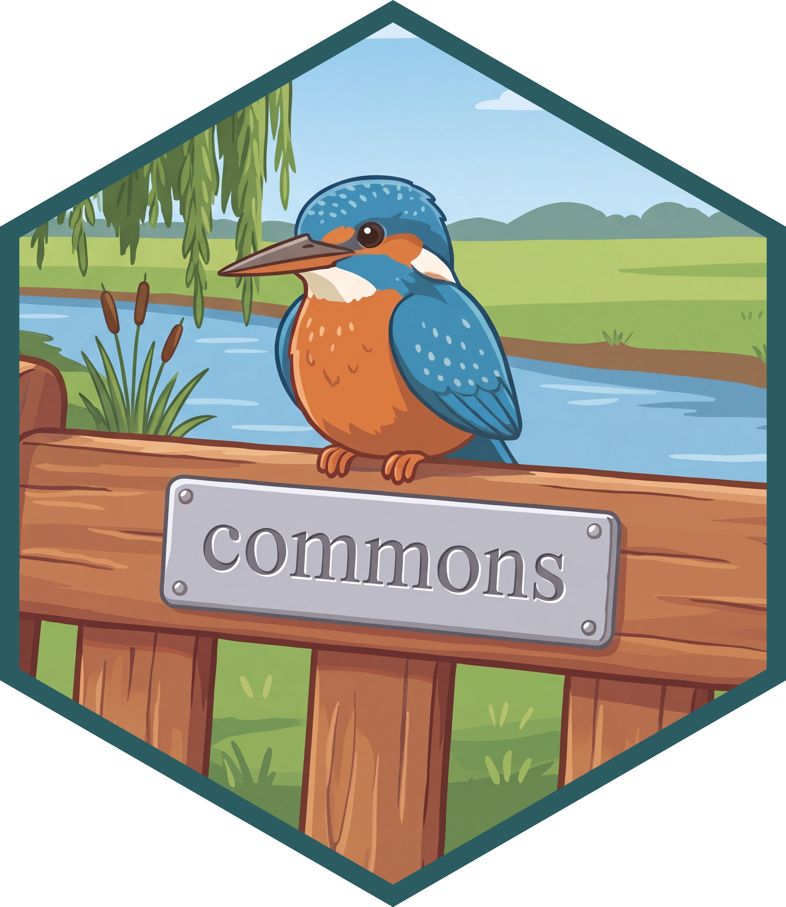
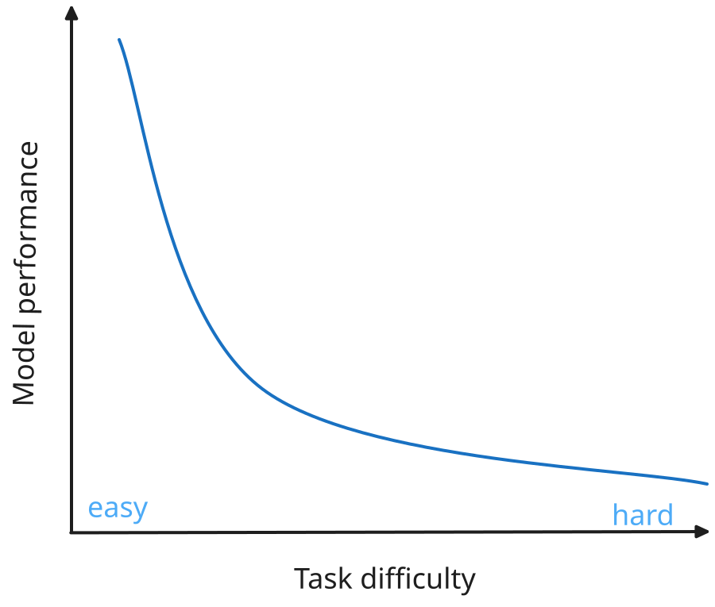
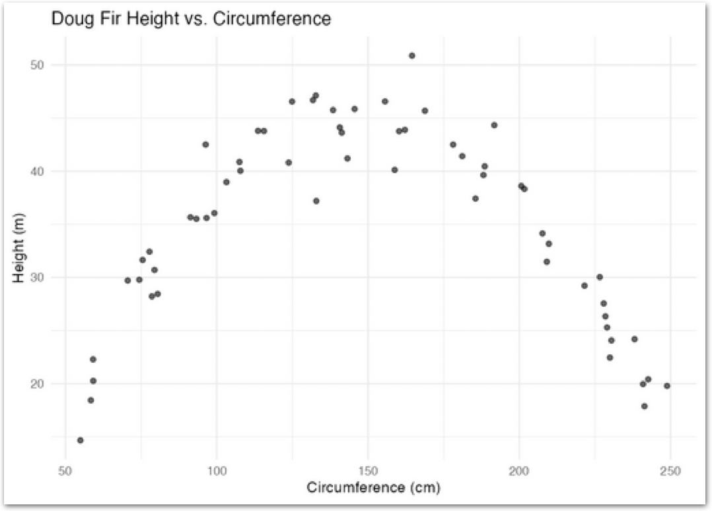
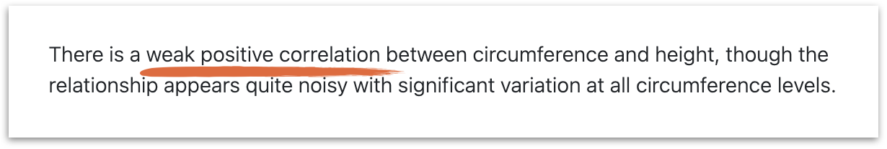
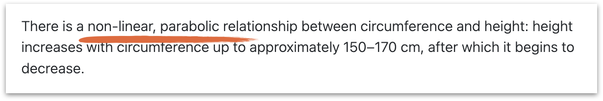
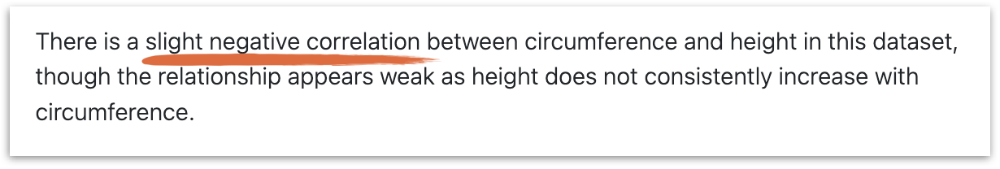
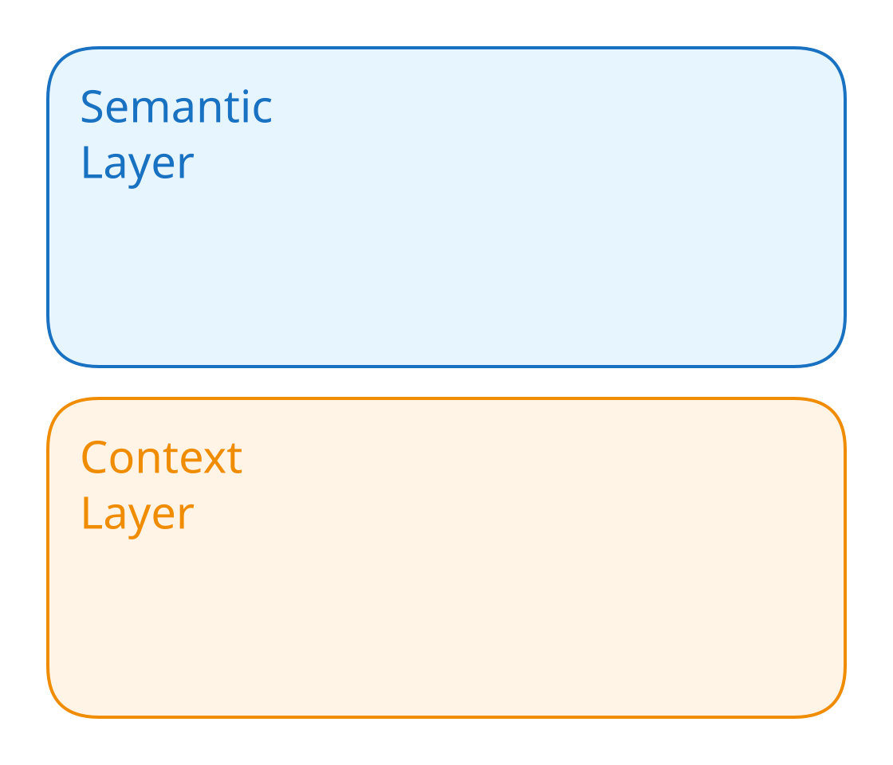
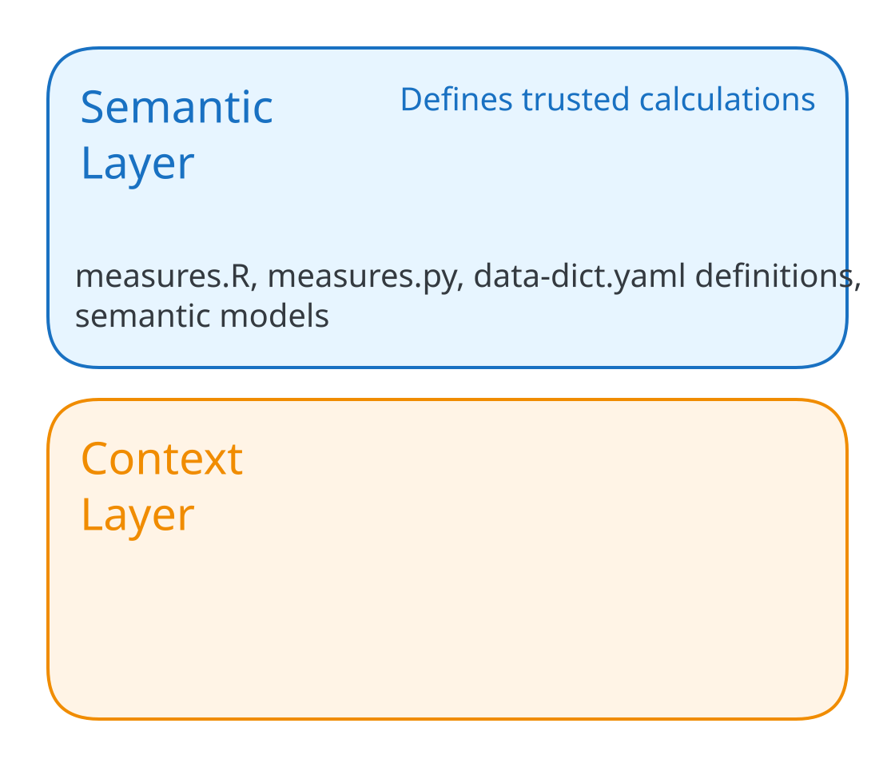
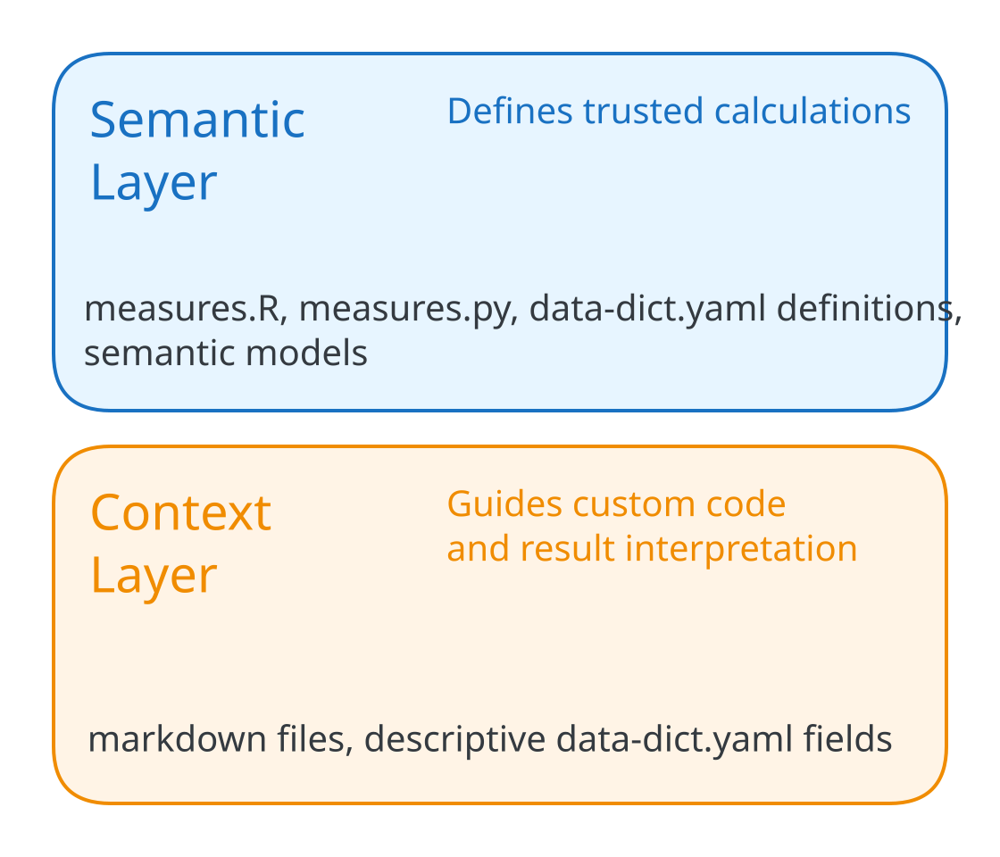

## {#title .title-slide .deep-slide}

::: {.columns}

::: {.column width="68%"}
### Trustworthy data agents with commons {.talk-title}

::: {.talk-meta}
**Sara Altman**

HMRC
October 20, 2026
:::
:::
:::

::: {.title-commons}
{.nostretch fig-alt="Commons hex sticker"}
:::

::: {.footer .title-footer}
https://skaltman.github.io/hmrc-2026/
:::


## {#non-data-scientist .paper-slide}

::: notes
llms open up data analysis to more people. it is now easier than ever to get _an_ answer to your data question, whether or not that answer is right

but what if the user is not a data scientist?
how do we help them get correct answers too?
:::

## {#test-set .paper-slide}

{.rounded .nostretch style="display: block; margin: 0 auto; max-width: 90%; max-height: 620px;" fig-alt="Screenshot of The Test Set podcast episode about rogue analysis in Cursor."}

::: notes
This is something we've seen internally at Posit and in organizations we
work with: it's becoming normal to vibe-analyze data.

The idea for the hypothetical we'll see later came from this episode of
The Test Set podcast.
:::

## How good are models at data analysis? {#story-of-an-eval .beat-slide}

```{r}
#| include: false
library(ggplot2)
library(dplyr)
library(forcats)
library(ggforce)
library(scales)

original_results_env <- new.env()
load("data/bluffbench-original-results.rda", envir = original_results_env)
bluffbench_original_results <- original_results_env$bluff_results

latest_results_env <- new.env()
load("data/bluffbench-latest-results.rda", envir = latest_results_env)
bluffbench_latest_results <- latest_results_env$bluff_results

bluff2_results_env <- new.env()
load("data/bluffbench2-latest-results.rda", envir = bluff2_results_env)
bluff2_latest_results <- bluff2_results_env$bluff2_results

bluffbench_results_theme <-
  theme_minimal(base_size = 22) +
  theme(
    plot.background = element_rect(fill = "#f5f0ee", color = NA),
    panel.background = element_rect(fill = "#f5f0ee", color = NA),
    legend.background = element_rect(fill = "#f5f0ee", color = NA),
    legend.key = element_rect(fill = "#f5f0ee", color = NA),
    panel.grid.minor = element_blank(),
    panel.grid.major = element_line(color = "#dedbd5"),
    text = element_text(color = "#3c4a52"),
    axis.text = element_text(color = "#3c4a52"),
    strip.background = element_blank(),
    strip.text = element_text(color = "#3c4a52", face = "bold"),
    plot.title.position = "plot"
  )

bluff2_summary <-
  bluff2_latest_results |>
  summarize(
    score = (sum(score == "C") + (sum(score == "P") * .5)) / n(),
    .by = model
  ) |>
  mutate(model = gsub(" (medium)", "", model, fixed = TRUE))
```


## {#bluffbench-counterintuitive-plot .paper-slide}

::: {.plot-slide-content .fragment data-fragment-index="0"}

```{r}
#| echo: false
#| fig-align: center
#| fig-alt: "A scatterplot of price against carat. The points form a clear negative association, with price generally falling as carat rises."
#| fig-width: 12
#| fig-height: 6
#| fig-bg: "#f5f0ee"
#| out-width: "92%"
bluffbench_diamonds <- ggplot2::diamonds |>
  mutate(carat = max(carat) - carat)

ggplot(bluffbench_diamonds, aes(x = carat, y = price)) +
  geom_point(size = 3, alpha = 0.2) +
  theme(
    plot.background = element_rect(fill = "#f5f0ee", color = NA),
    axis.title = element_text(size = 30, color = "#3c4a52"),
    axis.text = element_text(size = 22, color = "#3c4a52")
  )
```

:::

<div class="fragment fade-in-then-out plot-model-quote" data-fragment-index="1"><strong>Model:</strong> &ldquo;There&rsquo;s a strong positive relationship between carat and price!&rdquo;</div>

<div class="fragment plot-overlay-caption" data-fragment-index="2">Can models interpret plots that contradict their expectations?</div>

::: notes
around a year ago we did an experiment
we wanted to know how well models interpret plots
we showed them plots like this one, which plots diamonds and asked them to interpret them
and they said stuff like this: 
and that sounds good until you release: that is not ...

this is what we wanted to know: would models correctly interpret plots that contradicted their expectations?
:::

## November 2025 {#bluffbench-november-2025 .paper-slide}

::: {.plot-slide-content}

```{r}
#| echo: false
#| fig-align: center
#| fig-alt: "A horizontal stacked bar chart titled 'Models often report what they expect to see, not what's plotted.' GPT-5, Gemini Pro 2.5, and Claude Sonnet 4.5 are mostly incorrect."
#| fig-width: 12
#| fig-height: 7.5
#| fig-bg: "#f5f0ee"
#| out-width: "70%"
bluffbench_original_results |>
  filter(type == "mocked") |>
  mutate(score = fct_recode(score, "Correct" = "C", "Incorrect" = "I")) |>
  ggplot(aes(y = model, fill = score)) +
  geom_bar(position = "fill") +
  scale_fill_manual(
    name = NULL,
    breaks = c("Correct", "Incorrect"),
    values = c("Correct" = "#7fa8bd", "Incorrect" = "#c98a63")
  ) +
  scale_x_continuous(labels = scales::percent) +
  labs(
    title = "Models often report what they expect to see, not what's plotted",
    subtitle = "With well-known datasets",
    x = NULL,
    y = NULL
  ) +
  bluffbench_results_theme +
  theme(
    plot.title = element_text(size = 26, face = "bold"),
    plot.subtitle = element_text(size = 18),
    axis.text.x = element_text(size = 18),
    axis.text.y = element_text(size = 20),
    legend.position = "top",
    legend.justification = "left",
    legend.text = element_text(size = 18)
  )
```

:::

:::footer
posit-dev.github.io/bluffbench
:::

::: notes
We tried a range of interventions to improve these scores, but none moved them
much. 
:::

## September 2026 {#bluffbench-september-2026 .paper-slide}

::: {.plot-slide-content}

```{r}
#| echo: false
#| fig-align: center
#| fig-alt: "A faceted horizontal stacked bar chart of percent correct across recent models, split into thinking and no-thinking groups. Thinking models perform better, while most models still give many incorrect answers."
#| fig-width: 12
#| fig-height: 7.5
#| fig-bg: "#f5f0ee"
#| out-width: "70%"
bluffbench_latest_results |>
  filter(
    type == "mocked",
    release_date >= as.Date("2026-04-01")
  ) |>
  mutate(
    score = fct_recode(score, "Correct" = "C", "Incorrect" = "I"),
    pct_correct = ave(score == "Correct", model, FUN = mean),
    model = gsub(" \\((medium|non-thinking)\\)$", "", model),
    model = reorder(model, pct_correct),
    thinking = factor(
      ifelse(thinking, "Thinking", "No thinking"),
      levels = c("Thinking", "No thinking")
    )
  ) |>
  filter(thinking == "Thinking") |>
  ggplot(aes(y = model, fill = score)) +
  geom_bar(position = "fill") +
  scale_fill_manual(
    name = NULL,
    values = c("Correct" = "#7fa8bd", "Incorrect" = "#c98a63")
  ) +
  scale_x_continuous(labels = scales::percent) +
  labs(
    title = "Models got better at interpreting counterintuitive plots",
    x = "Percent correct",
    y = NULL
  ) +
  bluffbench_results_theme +
  theme(
    plot.title = element_text(size = 26, face = "bold"),
    axis.text.x = element_text(size = 18),
    axis.text.y = element_text(size = 14),
    axis.title.x = element_text(size = 22),
    strip.text = element_text(size = 22, hjust = 0),
    legend.position = "none",
    plot.margin = margin(5.5, 5.5, 15, 5.5)
  )
```

:::

:::footer
posit-dev.github.io/bluffbench
:::

::: notes
The newer models did substantially better on this eval.
This was a failure that worried us, and interventions hadn't helped much.
Model improvements changed the results, so our assessment needs to change too.
:::

## The models got better {#models-got-better .beat-slide}

## A rising tide lifts all boats {#rising-tide background-image="figures/vidar-nordli-mathisen-U45J8RWFWvA-unsplash.jpg"}

::: footer
<span style="color:#f5f1ec;">Photo: [Vidar Nordli-Mathisen](https://unsplash.com/@vidarnm), Unsplash</span>
:::

::: notes
the rising tide of model capability really floats all the boats
:::

## A rising tide lifts [some of the]{style="color: #b8623f;"} boats {#rising-tide background-image="figures/vidar-nordli-mathisen-U45J8RWFWvA-unsplash.jpg"}

::: footer
<span style="color:#f5f1ec;">Photo: [Vidar Nordli-Mathisen](https://unsplash.com/@vidarnm), Unsplash</span>
:::

## But this doesn't mean everything is solved {#frontier-model-not-enough .beat-slide}


## {#bluffbench2-data-artifact .paper-slide}

::: {.plot-slide-content}

```{r}
#| echo: false
#| fig-align: center
#| fig-alt: "A scatterplot of sleep hours against stress score with a negative trend. A subset of points falls exactly along a straight line, suggesting a data-quality artifact."
#| fig-width: 12
#| fig-height: 6
#| fig-bg: "#f5f0ee"
#| out-width: "92%"
set.seed(617)

n <- 150
n_imp <- 35
sleep_hours <- round(runif(n, 4, 10), 1)
stress_score <- round(
  pmin(pmax(95 - 7.5 * sleep_hours + rnorm(n, 0, 8), 5), 95),
  1
)

imp_sleep <- round(runif(n_imp, 4.5, 9.5), 1)
imp_stress <- round(95 - 7.5 * imp_sleep, 1)

wellbeing_data <- data.frame(
  sleep_hours = c(sleep_hours, imp_sleep),
  stress_score = c(stress_score, imp_stress)
)

ggplot(wellbeing_data, aes(x = sleep_hours, y = stress_score)) +
  geom_point(alpha = 0.8, size = 3) +
  labs(x = "sleep (hours)", y = "stress score") +
  theme(
    plot.background = element_rect(fill = "#f5f0ee", color = NA),
    axis.title = element_text(size = 30, color = "#3c4a52"),
    axis.text = element_text(size = 22, color = "#3c4a52")
  )
```

:::

:::footer
github.com/posit-dev/bluffbench2
:::

::: notes
we showed them plots that look like this
take a look at this plot. what do you notice?

one thing that flags my attention is these points through the middle of the cloud that fall exactly on a straight line. this is something i might want to dig into further and make sure nothing strange was happening in the underlying data.

we wanted to see if models would be able to pick up on this kind of subtle visual artifact
:::

## {#bluffbench2-results .paper-slide}

::: {.plot-slide-content}

```{r}
#| echo: false
#| fig-align: center
#| fig-alt: "A horizontal bar chart of bluffbench2 scores by model. Every model scores below 50 percent, showing that frontier models still struggle to notice subtle data-quality issues."
#| fig-width: 12
#| fig-height: 7
#| fig-bg: "#f5f0ee"
#| out-width: "78%"
bluff2_summary |>
  mutate(model = fct_reorder(model, score)) |>
  ggplot() +
  aes(x = score, y = model) +
  geom_col(fill = "#6e97a8") +
  scale_x_continuous(labels = label_percent(), limits = c(0, 1)) +
  labs(
    x = "Score",
    y = NULL,
    title = "Frontier models still struggle to notice subtle data quality issues"
  ) +
  bluffbench_results_theme +
  theme(
    plot.title = element_text(size = 26, face = "bold"),
    axis.text.y = element_text(size = 22),
    axis.text.x = element_text(size = 20)
  )
```

:::

:::footer
github.com/posit-dev/bluffbench2
:::

::: notes
Models have improved, but not every capability has improved equally.
:::

## {#llms-smooth .paper-slide}

{.nostretch style="max-width: 90%; max-height: 500px; display: block; margin-left: auto; margin-right: auto;" fig-alt="A schematic showing an expected straight-line relationship between task difficulty and model performance."}

## LLMs are jagged {#llms-are-jagged .paper-slide}

{.nostretch style="max-width: 90%; max-height: 500px; display: block; margin-left: auto; margin-right: auto;" fig-alt="A schematic showing LLM performance rising and falling unevenly across tasks of increasing difficulty."}

::: notes
a year ago, we often told people about the jaggedness of llms
strengths in one task don't
tell us everything about performance on another.
:::

## {#capability-profiles .paper-slide}

```{r}
#| label: setup-capability-profiles
#| include: false
source("R/capability-profiles.R")
```

::: {.r-stack}

::: {.fragment .fade-out data-fragment-index="0"}

```{r}
#| label: capability-profile-first
#| echo: false
#| dev: png
#| dev-args: {bg: transparent}
#| fig-width: 10
#| fig-height: 6
#| fig-dpi: 160
#| fig-format: png
#| fig-bg: transparent
#| fig-align: center
#| out-width: "85%"
#| fig-alt: "An illustrative five-axis capability profile: planning, writing, code review, refactor, and data analysis."
capability_profile_plot(c(0.8, 0.6, 0.5, 0.85, 0.3), title = "Model 1")
```

:::

::: {.fragment .current-visible data-fragment-index="0"}

```{r}
#| label: capability-profile-other
#| echo: false
#| dev: png
#| dev-args: {bg: transparent}
#| fig-width: 10
#| fig-height: 6
#| fig-dpi: 160
#| fig-format: png
#| fig-bg: transparent
#| fig-align: center
#| out-width: "85%"
#| fig-alt: "A different illustrative model profile on the same five capability axes."
capability_profile_plot(c(0.45, 0.85, 0.8, 0.4, 0.65), title = "Model 2")
```

:::

::: {.fragment data-fragment-index="1"}

```{r}
#| label: capability-profile-newer
#| echo: false
#| dev: png
#| dev-args: {bg: transparent}
#| fig-width: 10
#| fig-height: 6
#| fig-dpi: 160
#| fig-format: png
#| fig-bg: transparent
#| fig-align: center
#| out-width: "85%"
#| fig-alt: "An illustrative newer-release profile on the same five capability axes."
capability_profile_plot(c(0.9, 0.7, 0.75, 0.8, 0.75), title = "Model 1.1")
```

:::

:::

::: notes
now I might explain it more like this
where a model has different strengths in different areas and maybe some weird behaviors
but also this varies model by model
and version by version 

one reason i would now not say "use the best model available"
but instead use the least expensive model that does a sufficient job at your task, and switch depending on the task.
:::

# {#deficits-slide .statement-slide .paper-slide}

::: {.statement}
Models still have deficits in skills central to data analysis. 
:::


# {#context-outside-the-data .statement-slide .beat-slide}

::: {.statement}
Data analysis depends on [context]{.accent} that is not in the data.
:::

::: notes
also even if models were perfect, data analysis isn't solved. depends on context
Definitions, conventions, documentation, and tacit organizational knowledge
don't automatically become available to an LLM just because it is more capable.

That context might live in data dictionaries, semantic views, or in the mind
of a coworker who has been at the organization for 20 years.

Depending on your organization's setup, making that context available can be a lot of work in itself.
:::

## {#context-messy-desk background-image="figures/wonderlane-6jA6eVsRJ6Q-unsplash.jpg"}

::: footer
<span style="color:#f5f1ec;">Photo: [Wonderlane](https://unsplash.com/@wonderlane), Unsplash</span>
:::

## How do we make data analysis agents trustworthy? {#trust-question .deep-slide}

::: notes
We can't get there just by choosing a good model and telling people to be
careful. We have to build trustworthiness into the environment around it.
:::

## Two problems {#two-problems .two-problems-slide}

```{=html}
<div class="problem-grid">
  <div class="problem-card fragment" data-fragment-index="0">
    <span class="problem-number" aria-hidden="true">01</span>
    <p class="problem-statement">The model has to write the right code.</p>
  </div>
  <div class="problem-card fragment" data-fragment-index="1">
    <span class="problem-number" aria-hidden="true">02</span>
    <p class="problem-statement">The user has to know how trustworthy the code is.</p>
  </div>
</div>
```

# {#commons .commons-intro-slide}

{.commons-intro-logo .nostretch fig-alt="Commons logo"}

:::footer
https://pos.it/commons
:::

::: notes
this is exactly the problem that commons is trying to solve

commons helps data scientists build trustworthy data agents for their collaborators that give more correct, reproducible, and transparent answers than the default "vibe analysis" siutation, while still being easy and intuitive to use. 

It's an open source R and Python package built on `ellmer` / `chatlas` and `shinychat`. You can use it with whatever model from whatever provider you want.

and it's a bird because...
:::


# [_Trusted_ code]{#trusted-code style="color: #b8623f; font-size: 1.4em;"}

::: notes
one of the core ideas behind commons is that data teams have trusted code ...

This vetted code used by the data scientists is what we'll called _trusted_ code
they rely on it and trust it to give them the right answers

They also might have trusted code in

* Shiny apps
* R and Python packages
* Quarto documents

Instead of the model writing code afresh every time it's answering a question, what if it could discover and use this trusted code?

This is one of the core ideas behind a new open source package that we're excited to share with you all today. It's called commons.
:::


## commons does 3 things

:::incremental
* Extract trusted calculations from existing artifacts into a data structure
* A harness to give the right context at the right time
* A feedback loop to push more queries up the trust ladder over time
:::

## {#commons-trusted-calculation}

<video class="rounded click-to-toggle" width="100%" preload="auto" data-autoplay muted tabindex="0" aria-label="Commons recording: the agent searches for and runs the data scientist's site traffic calculation, and the answer is marked verified. Click to pause or resume.">
  <source src="figures/commons-01-traffic-trend-a.mp4" type="video/mp4">
</video>

::: notes
Let's see it in action

The first thing the agent does is search for a trusted calculation. Here it
finds and runs a trusted site traffic calculation.

The answer is marked as verified to signify that it used vetted code.
:::

## {#commons-context-citations}

<video class="rounded click-to-toggle" width="100%" preload="auto" data-autoplay muted tabindex="0" aria-label="Commons recording: the agent searches context, writes custom code, and presents a checked citation. Click to pause or resume.">
  <source src="figures/commons-02-page-views-a.mp4" type="video/mp4">
</video>

::: notes
However, it's unlikely that trusted code will cover all questions a user
might have. For these situations, the agent can write custom R, Python, or
SQL.

First, the agent looks through additional context in the form of data
dictionaries, markdown files, and, if you have them, existing context layers
from Databricks and Snowflake.

Then, it writes whatever code it needs to find an answer.

Finally, when it presents an answer, it can provide a citation to that
context. The citation is deterministically checked against trusted context
that has appeared in the conversation -- if it matches, a citation tag is
shown.
:::

## {#commons-context-citations-b}

<video class="rounded click-to-toggle" width="100%" preload="auto" data-autoplay muted tabindex="0" aria-label="Commons recording: continuation of the context and citation example. Click to pause or resume.">
  <source src="figures/commons-02-page-views-b.mp4" type="video/mp4">
</video>

## {#commons-lower-trust-answer}

<video class="rounded click-to-toggle" width="100%" preload="auto" data-autoplay muted tabindex="0" aria-label="Commons recording: the agent cannot find trusted context, and its answer carries a lower-trust tag. Click to pause or resume.">
  <source src="figures/commons-03-most-visits-a.mp4" type="video/mp4">
</video>

::: notes
There's one more possible path: the model cannot find trusted context to
justify its approach. In this case, we mark the answer with a yellow tag,
which lets the user know the answer should be considered less trusted.

The tool has to feel
convenient enough that the user actually wants to reach for it -- it needs
to feel like a normal chat. When correctness is closer to a normal coding
agent, we signal that the user ought to be more skeptical of the answer.
:::

## {#commons-lower-trust-answer-b}

<video class="rounded click-to-toggle" width="100%" preload="auto" data-autoplay muted tabindex="0" aria-label="Commons recording: continuation of the lower-trust example. Click to pause or resume.">
  <source src="figures/commons-03-most-visits-b.mp4" type="video/mp4">
</video>

## Two problems, revisited {#two-problems-revisited .two-problems-slide}

```{=html}
<div class="problem-grid">
  <div class="problem-card">
    <span class="problem-number" aria-hidden="true">01</span>
    <p class="problem-statement">The model has to write the right code.</p>
    <p class="problem-solution fragment" data-fragment-index="0">Trusted calculations + organizational context</p>
  </div>
  <div class="problem-card">
    <span class="problem-number" aria-hidden="true">02</span>
    <p class="problem-statement">The user has to know how trustworthy the code is.</p>
    <p class="problem-solution fragment" data-fragment-index="1">Execution-based tags + checked context citations</p>
  </div>
</div>
```

## {#why-not-model-grade .paper-slide}

::: notes
why not have the model assign the trust levels?
:::

## The answers look the same {#answers-look-the-same .paper-slide}

<div style="display:flex; flex-direction:row; align-items:center; justify-content:center; gap:34px; margin-top:24px;">

<div style="display:flex; flex-direction:column; gap:22px;">
<div style="position:relative;">

<span class="fragment" data-fragment-index="4" style="position:absolute; top:50%; right:16px; transform:translateY(-50%); font-size:2.4em; line-height:1; text-shadow:0 0 8px #fff, 0 0 8px #fff;">❌</span>
</div>
<div style="position:relative;">

<span class="fragment" data-fragment-index="4" style="position:absolute; top:50%; right:16px; transform:translateY(-50%); font-size:2.4em; line-height:1; text-shadow:0 0 8px #fff, 0 0 8px #fff;">✅</span>
</div>
<div style="position:relative;">

<span class="fragment" data-fragment-index="4" style="position:absolute; top:50%; right:16px; transform:translateY(-50%); font-size:2.4em; line-height:1; text-shadow:0 0 8px #fff, 0 0 8px #fff;">❌</span>
</div>
</div>
</div>

::: notes
The problem with this performance just that the model is sometimes wrong, it's that the wrong answers are confident and can be indistinguishable from the right ones

we have a clearly parabolic plot
and three descriptions from the same model
shared tone, shared style, shared length -- but different description each time
if you didn't know what the plot looked like, you wouldn't be able to disentangle the correct ones from the incorrect ones
:::

## {#commons-trust-flow .trust-flow-slide .paper-slide}

<br>

```{=html}
<div class="trust-flow" role="img" aria-label="Commons searches trusted calculations, then marks answers based on whether they use a trusted calculation or a lower-trust custom path.">
  <div class="trust-tool trust-search">Search trusted calculations</div>
  <div class="trust-route-labels" aria-hidden="true">
    <span><span>Find one</span><span class="trust-decision-arrow">↓</span></span>
    <span><span>Don’t find one</span><span class="trust-decision-arrow">↓</span></span>
  </div>
  <div class="trust-branches">
    <div class="trust-branch trust-branch-high">
      <div class="trust-tool">Run trusted calculation</div>
      <span class="trust-down-arrow" aria-hidden="true">↓</span>
      <div class="trust-marker">
        
      </div>
    </div>
    <div class="trust-branch trust-branch-lower">
      <div class="trust-tool">Search context</div>
      <span class="trust-down-arrow" aria-hidden="true">↓</span>
      <div class="trust-tool">Write SQL/R/Python</div>
      <div class="trust-citation-routes" aria-hidden="true">
        <span><span>Cite</span><span class="trust-decision-arrow">↓</span></span>
        <span><span>Don’t cite</span><span class="trust-decision-arrow">↓</span></span>
      </div>
      <div class="trust-lower-outcomes">
        <div class="trust-marker">
          
        </div>
        <div class="trust-marker">
          
        </div>
      </div>
    </div>
  </div>
</div>
```

::: notes
Commons records which tools produced the answer. Trust is based on that
execution path, not on the model's confidence in its own answer. trust is deterministic

The citation itself is checked against trusted context. A custom answer is not
promoted merely because the model says it used a trusted source.
:::

# Demos {#demos .beat-slide}

## {#devrel-agent .header-slide .deep-slide}

::: {.columns}

::: {.column .header-text width="64%"}
DevRel Agent
:::

:::

::: {.footer .clinical-trials-header-footer}
https://github.com/posit-dev/devrel-agent
:::


::: notes
Live demo: https://posit-devrel-agent.share.connect.posit.cloud/
:::

# {#clinical-trials-agent .header-slide .deep-slide}

::: {.columns}

::: {.column .header-text width="64%"}
Clinical trials agent
:::

::: {.column width="36%"}
{.header-image fig-alt="Clinical trials agent logo"}
:::

:::

::: {.footer .clinical-trials-header-footer}
[https://github.com/posit-dev/clinical-trials-agent](https://github.com/posit-dev/clinical-trials-agent)
:::

## {#clinical-trials-agent-demo}

<video class="rounded click-to-toggle" width="100%" data-autoplay muted preload="auto" tabindex="0" aria-label="Clinical Trials Agent demo. Plays automatically; click to pause or resume.">
  <source src="figures/clinical-trials-agent-demo.mp4" type="video/mp4">
</video>

## {#commons-lifecycle .lifecycle-slide .paper-slide}

::: {.lifecycle-cards}
::: {.lifecycle-card .fragment .fade-up}
### Build

You construct the agent by hooking it up to trusted code.
:::

::: {.lifecycle-card .fragment .fade-up}
### Deploy

Your colleagues use the agent deployed on Connect.
:::

::: {.lifecycle-card .fragment .fade-up}
### Improve

You review the agent's behavior, adding trusted code to cover common use cases.
:::
:::

::: notes
After seeing the agents in action, what does this look like for the person
building and maintaining them?

Build: connect vetted calculations, data, and organizational context.
Deploy: make the agent available to collaborators, for example on Connect.
Improve: review its behavior and add calculations or context for recurring questions.
:::

## Build: the commons skill {#build-onboarding .paper-slide}

::: {.incremental}
* Use a coding agent plus the built-in commons skill to parse through your data and code and build a commons agent.
:::

::: footer
[https://posit-dev.github.io/commons/r/articles/commons.html#working-with-the-agent-skill](https://posit-dev.github.io/commons/r/articles/commons.html#working-with-the-agent-skill)
:::

::: notes
The commons package ships as a skill for coding agents (Posit Assistant,
Claude Code, Codex). 
:::

## Information Layers {#information-layers-photo background-image="figures/olga-petnyunene-lJ5xPIp4iSc-unsplash.jpg" background-size="cover"}

::: footer
<span style="color:#f5f1ec;">Photo: [Olga Petnyunene](https://unsplash.com/@12tones), [Unsplash](https://unsplash.com/photos/a-piece-of-chocolate-cake-on-a-plate-lJ5xPIp4iSc)</span>
:::

## Build: information layers {#information-layers .paper-slide}

{.nostretch style="display: block; margin: 0 auto; height: 580px; width: auto; max-width: 90%;" fig-alt="A diagram identifying two information layers: the semantic layer and the context layer."}

::: notes
These layers complement the data source. The semantic layer supplies
trusted ways to compute answers. The context layer helps the agent write
custom SQL or R and interpret the results when a trusted calculation
doesn't cover the question.

Data dictionaries can contribute to both: calculation definitions to the
semantic layer, and descriptive information to the context layer.
:::

## Build: information layers {#build-semantic .paper-slide}

{.nostretch style="display: block; margin: 0 auto; height: 580px; width: auto; max-width: 90%;" fig-alt="The two-layer diagram now explains that the semantic layer defines trusted calculations, supplied by R or Python measures, data dictionary definitions, and semantic models."}

::: notes
Trusted calculations specify how an answer is computed. Define vetted R or
Python functions as measures in scripts.

The semantic layer collects the vetted calculations the agent prefers to
use. Functions documented with @measure become measures; the roxygen
description and @param tags become the tool's description and arguments.

The enrollment example is illustrative, not a statement about J&J's definitions.
The point is to reuse the team's calculation rather than have the model
reinvent its logic for each question. Measures can contain ordinary R code;
they do not have to contain SQL or a dbGetQuery call.
The same trusted calculations can also come from data dictionary
definitions, Snowflake semantic views, or Databricks metric views.
:::

## Build: information layers {#build-context .paper-slide}

{.nostretch style="display: block; margin: 0 auto; height: 580px; width: auto; max-width: 90%;" fig-alt="The complete diagram adds that the context layer guides custom code and result interpretation, using Markdown files and descriptive data dictionary fields, alongside the semantic layer's trusted calculations."}

::: notes
The context layer explains what the data means and how to interpret it.

Markdown files and descriptive entries in data dictionaries supply context:
what columns mean, terminology, conventions, and limitations.

Data dictionaries can serve both layers: descriptive fields supply context,
while calculation definitions supply the semantic layer.
:::

## Build {#build-agent .paper-slide}

#### Putting the pieces together

```r
library(commons)

agent <- commons(
  ellmer::chat_anthropic(),
  data_sources = data_source(trials = trials),
  semantic_layer = semantic_layer("R/measures.R"),
  context_layer = context_layer(files = "context/protocol-conventions.md")
)

commons_app(agent)
```

::: notes
This assembles a chat client, data source, semantic layer, and context layer;
commons wraps them with trusted-calculation tools, context search, provenance
marking, and a sandboxed R session.

The `R/measures.R` and `context/protocol-conventions.md` paths illustrate
existing files that supply vetted R measures and organizational context. This
is not a self-contained runnable example without those files and its data.
:::

::: notes
This is the whole agent: a chat client, a data source, and commons wraps it
with trusted-calculation tools, context search, provenance marking, and a
sandboxed R session.

The data source here is a data frame (a clinical trials table), which commons
loads into an in-process DuckDB database. The semantic and context layers are
optional and grow over time -- start with a small working scope and expand.
:::

## Build {#build-warehouse .paper-slide}

#### Databricks and Snowflake

```r
# Snowflake semantic view
warehouse <- data_source(
  snowflake_con, tables = "ANALYTICS.TRIAL_ENROLLMENT"
)

# Or: Databricks metric view
warehouse <- data_source(
  databricks_con, tables = "clinical.trial_enrollment_metrics"
)

agent <- commons(
  ellmer::chat_anthropic(),
  data_sources = list(warehouse = warehouse),
  context_layer = context_layer(files = "context/protocol-conventions.md")
)
```

::: {.incremental}
* **Semantic layer:** Snowflake **semantic views** or Databricks **metric views**, imported through `data_source()`
:::

::: notes
The two warehouse objects above supply trusted metrics and dimensions:
Snowflake calls them semantic views; Databricks calls them metric views.
commons imports these through the data source, so they do not require a
separate semantic_layer() call.

Warehouse models need not supply only calculations: the Databricks
integration also imports descriptive context from metric views. Do not
present warehouse metadata and context as mutually exclusive categories.

* **Context:** warehouse models can also supply descriptive information. Add additional information to Markdown files and data dictionaries
:::


## Deploy {#deploy-connect .paper-slide}

::: {.incremental}
* Deploy like any other Shiny app.
* (Optional) Enable built in trajectory-logging.
* Enforce access with warehouse permissions and per-viewer credentials.
:::

::: notes
Create DBI connections
and the agent inside the Shiny server for each session, using Connect viewer
OAuth. The supplied connection enforces warehouse row-level security and
table- and column-level policies.
:::

## Improve: analyze trajectories {#trajectory-review .paper-slide}

::: {.incremental}
* `commons(log = TRUE)` records conversation histories with OpenTelemetry.
* `trajectory_read()` reads trajectories from Connect or local traces.
* `trajectory_review()` opens a Shiny app to browse, flag, and annotate conversations.
:::

::: notes
We'll demo the trajectory reviewer here. Reviewed conversations surface
recurring questions, then you add trusted calculations or context. The goal
is to improve the system, not just ask users to check answers more
carefully. These reviewer functions are in the R package.

Go to trajectory reviewer 

https://01a13e15-380b-24ec-91a0-f7e07302f411.share.connect.posit.cloud/
:::

## Code as the foundation

::: {.incremental}
* LLMs are good at writing code
* Reproducible, transparent, auditable
:::

::: notes
the primary thing, that might seem obvious but isn't always obvious
is that the model needs to write code

as much as possible, get it to write code
does the agent have to run code? no --
it could do things "in its head," but then you lose reproducibility and transparency.

llms are good at code

we've learned from years of code for analysis that code is great for this
:::

## Which tool is which?{#ecosystem .paper-slide}

| | Use |
|---|---|
| [Posit Assistant](https://assistant.posit.co/) | Get help with coding and data analysis in your development environment |
| [commons](https://posit-dev.github.io/commons/) | Build general data-analysis agents for colleagues, grounded in your team’s trusted code |
| [shinychat](https://posit-dev.github.io/shinychat/) | Build custom Shiny apps with chat components |
| [querychat](https://posit-dev.github.io/querychat/) | Explore tabular data through SQL-powered chat |

# {#thank-you .thank-you-slide .deep-slide}

```{=html}
<div class="thank-you-wrap">
  <div class="thank-you-row">
    <h1>Thank you!</h1>
  </div>
  <div class="thank-you-resources">
<a class="thank-you-resource thank-you-link-card thank-you-slides-card" href="https://skaltman.github.io/hmrc-2026/">
      <span class="thank-you-resource-label">Slides</span>
      <span class="thank-you-resource-link">skaltman.github.io/<wbr>hmrc-2026/</span>
    </a>
    <a class="thank-you-resource thank-you-link-card thank-you-commons-card" href="https://pos.it/commons">
      <span class="thank-you-resource-label">Commons</span>
      <span class="thank-you-resource-link">pos.it/commons</span>
    </a>
    <div class="thank-you-resource thank-you-link-card thank-you-demos-card">
      <span class="thank-you-resource-label">Demos</span>
      <a href="https://github.com/posit-dev/clinical-trials-agent">
        <span class="thank-you-demo-url">https://github.com/<wbr>posit-dev/<wbr>clinical-trials-agent</span>
      </a>
      <a href="https://github.com/posit-dev/devrel-agent">
        <span class="thank-you-demo-url">https://github.com/<wbr>posit-dev/<wbr>devrel-agent</span>
      </a>
    </div>
    <a class="thank-you-resource thank-you-link-card thank-you-newsletter-card" href="https://pos.it/ai-newsletter">
      <span class="thank-you-resource-label">AI Newsletter</span>
      <span class="thank-you-resource-link">pos.it/ai-newsletter</span>
    </a>
  </div>
</div>
```


